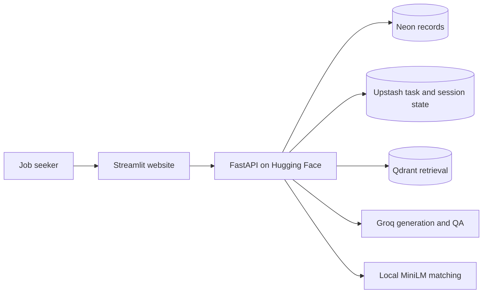

# Deployment and recovery

[Documentation](docs/README.md) · [Configuration](docs/CONFIGURATION.md) · [Verified status](docs/PROJECT_STATUS.md)

The public demo runs on **Streamlit Community Cloud + Hugging Face Spaces**, with
Neon PostgreSQL, Upstash Redis and Qdrant Cloud. AWS is a standby reference.
This guide describes the current checkout; unreleased changes are identified
in [project status](docs/PROJECT_STATUS.md).

## Active topology



| Surface | Address / source |
|---|---|
| Website | https://deeason-career.streamlit.app |
| API | https://deeason-careerhub.hf.space |
| Backend source | `backend/`, synced to the Space by GitHub Actions |
| Frontend source | `main`, entrypoint `frontend/app.py` |
| Workflow | [pipeline.yml](.github/workflows/pipeline.yml) |

Free service plans can sleep, impose quotas or suspend resources. No uptime or
zero-bill guarantee is implied. The old AWS custom domain is parked.

## Release flow

1. Work on a short-lived branch; PR into `develop` with the required checks.
2. Finish release notes and use the release workflow/script to update the five
   version carriers: settings, API example, changelog, latest README release and
   infrastructure banner. The script does not write product outcomes for you.
3. Merge the reviewed release from `develop` into `main`. This is the deployment
   trigger; production migrations run during backend startup.
4. Verify the expected version, dependency readiness and the user journey.

The pipeline runs on PRs to `main`/`develop`, pushes to `main`, and manual dispatch.
Pushing a feature or housekeeping branch publishes its commits but does not, by
itself, run this pipeline or deploy the application.
Its explicit deploy jobs depend on backend and frontend CI:

| Target | GitHub environment | Repository switch |
|---|---|---|
| Hugging Face backend | `free-prod` | `FREE_DEPLOY_ENABLED=true` |
| AWS API/frontend images | `production` | `AWS_DEPLOY_ENABLED=true` |

Streamlit independently redeploys from `main`; it does not wait for an Actions job.
Require passing PR checks before merging. A green backend upload alone cannot
establish that either frontend or API actually serves the new release.

## Hosted configuration

Create a Docker Space using [backend/README.md](backend/README.md)'s front matter:
`app_port: 8000` matches uvicorn. CI mirrors `backend/` and the Space builds
[backend/Dockerfile](backend/Dockerfile). Use `HF_TOKEN` in `free-prod` and optional
repository variables `HF_SPACE` and `FREE_API_BASE` to select the target.

Configure database, signing, LLM and vector credentials in **Space secrets**. Use
`DB_SSLMODE=require`, `REDIS_SSL=true`, and both Redis logical database indexes `0`
for the current managed providers. Set `PRODUCTION=true`, the allowed frontend origin,
and the admin secret required for cleanup. The complete setting reference and
placeholder template are in [CONFIGURATION](docs/CONFIGURATION.md).

The image bundles MiniLM and verifies offline inference as its serving user.
`ATS_MODEL_PATH` selects the saved model directory; local development can use the
Hub cache. The local production-image build and offline check passed on 2026-10-27;
repeat them for a changed release candidate. They do not prove deployed availability.

For Streamlit, select the repository, `main`, and `frontend/app.py`; configure
`API_URL=https://deeason-careerhub.hf.space/api/v1` through its supported settings.
Its dependencies live in `frontend/requirements.txt`. Confirm the host's Python
version matches the version exercised by frontend CI.

## Readiness and incident recovery

```sh
python3 .github/scripts/readiness.py \
  --api-base https://deeason-careerhub.hf.space \
  --frontend-url https://deeason-career.streamlit.app \
  --attempts 3
```

The checker requires DB/vector/semantic readiness, allows Redis only when healthy
or explicitly disabled, and verifies Streamlit's runtime state **and** runtime health.
For a release, also pass `--expected-version X.Y.Z`.

| Symptom | Check and recovery |
|---|---|
| Website shows a sleep page | Open the website and use Streamlit's wake control; verify runtime health afterward |
| Outer page returns 200 but app fails | Inspect Streamlit runtime status/logs; the hosting wrapper is not the application |
| API edge fails | Inspect the Space build/runtime/logs; distinguish provider error pages from API errors |
| API dependency is down | Inspect the named provider and configured connection; a suspended service may require console recovery |
| Model unavailable | Inspect server logs and the saved model bundle; a healthy vector database does not prove inference |
| Sign-in temporarily fails | Check API/Redis readiness; avoid clearing valid sessions during service errors |

The new semantic health field is absent from released v4.4.3. The stronger checker
will reject that older response until the matching backend change is deployed;
this is missing evidence, not proof the old model is broken. A live v4.4.3 scoring
sample passed on 2026-10-26.

## Monitoring and document cleanup

[keepwarm.yml](.github/workflows/keepwarm.yml) configures six-hour warming and a
separate daily **03:00 UTC** cleanup. Manual dispatch also runs cleanup. It calls
`POST /api/v1/admin/lifecycle/run` with the `free-prod` admin secret.
A failed warm job and a failed cleanup job are separate incidents; inspect both.

Scheduled Actions can be disabled after repository inactivity. The optional
[Cloudflare Worker](infra/keep-warm/README.md) is an alternate scheduler, with its
own configuration and verification obligations. Its frontend probe checks only an
HTTP response and does not verify the Streamlit runtime or semantic inference;
use the shared readiness checker for release validation. A scheduler is not a guarantee
against provider suspension. Monitor actual run results and app behavior.

Expired SQL documents are eligible for cleanup after the configured TTL. Derived
vectors, account records, backups and logs have separate retention concerns;
[SECURITY](SECURITY.md) documents incomplete deletion coverage.

## Validate before calling a release ready

Run local/CI checks from [CONTRIBUTING](CONTRIBUTING.md), build the production image,
run the real-model evaluation, and verify the intended release version. Then run
**Live Smoke** in Actions and exercise the browser with synthetic data: login,
upload, match, generation/refinement, PDF export and tracker update.

Live Smoke creates a synthetic account/documents and uses actual LLM calls. Its
current cleanup coverage is limited; remove probe records or inspect lifecycle
results afterward. Do not run it repeatedly as a free health ping.

## AWS standby

The AWS target remains disabled until restored and validated. Resource references
are in [INFRASTRUCTURE](INFRASTRUCTURE.md); operating and restoration procedures are
in [AWS operations](docs/deployment/AWS.md). Enabling a variable alone does not
restore deleted resources. No AWS mutation is part of routine local housekeeping.
