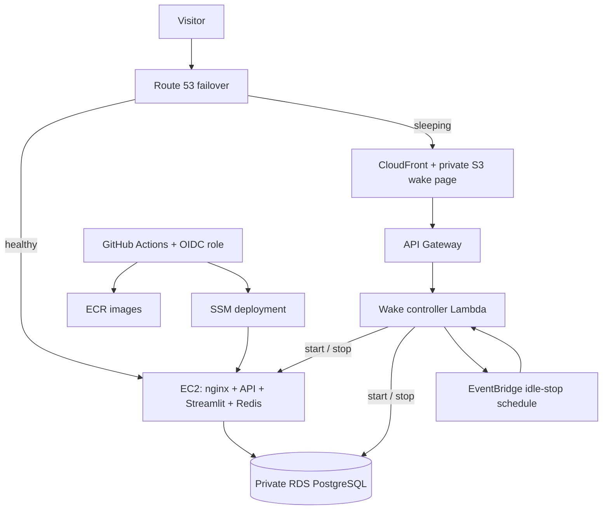

# Infrastructure reference

> Last updated: 2026-10-26 | Platform version: v4.4.3 | AWS reference region: `us-east-1`

The demo runs on managed hosting. AWS is a retained deployment option whose
compute/database stack was deprovisioned in July 2026. This inventory describes
application dependencies and the historical AWS design; it is not a live cloud audit.

## Active application dependencies

| Component | Hosted target | Role |
|---|---|---|
| Frontend | Streamlit Community Cloud | Candidate workflow and server-side API client |
| API | Hugging Face Docker Space | Authentication, documents, scoring and generation |
| Relational data | Neon PostgreSQL | Accounts, resumes, letters, revisions and applications |
| Short-lived state | Upstash Redis | Task progress, revocation and rate limits |
| Retrieval | Qdrant Cloud | User-scoped document vectors outside ephemeral container disk |
| Generation | Groq | Structured generation and model QA |
| Monitoring and cleanup | GitHub Actions | Dependency/runtime probes; daily SQL lifecycle cleanup |

See [Deployment](DEPLOYMENT.md) for URLs, release gates, readiness checks and recovery,
[Configuration](docs/CONFIGURATION.md) for environment variables, and
[Architecture](docs/ARCHITECTURE.md) for request/data flows. Free service tiers do not
establish an uptime guarantee. Provider settings and billing must be checked directly.

## Retained AWS design

| Asset | Retained configuration / historical design |
|---|---|
| Compute | `portfolio-server`, Ubuntu, historical `t3.small`; SSM administration |
| Database | `portfolio-db`, private PostgreSQL; restoration needs a verified backup |
| Images | `careerhub-backend`, `careerhub-frontend` in ECR; SHA tags for rollback |
| Secrets | `/portfolio/careerhub/` in SSM; runtime environment delivered on host |
| CI identity | `AWS_ROLE_ARN` OIDC role scoped to the GitHub `production` environment |
| Wake controller | `portfolio-wake-controller`; Lambda + API Gateway |
| Domain | `careerhub.deeason.com.np`, currently parked rather than the active demo |
| TLS proxy | `infra/nginx/nginx.conf`; certificates mounted on restored host |
| Logs | CloudWatch container/Lambda groups; current retention requires verification |
| Scheduling | Optional business hours and 90-minute idle-stop design |

A stopped instance can be awakened; a deleted stack must first be reconstructed.
The `AWS_DEPLOY_ENABLED` switch only permits an existing workflow to run. It cannot
restore IAM, credentials, networking, certificates, databases or deleted compute.
Retained DNS zones and snapshots can incur charges. No current $0 cost or historical
cold-start duration is claimed.

## Source and operating procedures

| Source | Purpose |
|---|---|
| [AWS operations](docs/deployment/AWS.md) | Restoration gates, deploy/rollback, scheduling and TLS |
| [Production Compose](docker-compose.prod.yml) | Container wiring, host mounts, logging and health checks |
| [Pipeline](.github/workflows/pipeline.yml) | Conditional AWS and managed-backend deployment jobs |
| [Infrastructure scripts](infra/scripts/) | Operational commands; read current usage before execution |
| [Wake page/controller](infra/wake-page/) | Historical wake-on-visit implementation |
| [Local Compose](docker-compose.yml) | Localhost-bound development services; separate from AWS |
| [Changelog](CHANGELOG.md) | Versioned infrastructure and application history |

API liveness during boot can precede database migrations and model readiness.
Restoration acceptance must exercise dependencies and a user workflow, not merely
`GET /health`. AWS resources, IAM access, billing and restoration have not been
revalidated during the current housekeeping checkpoint.
