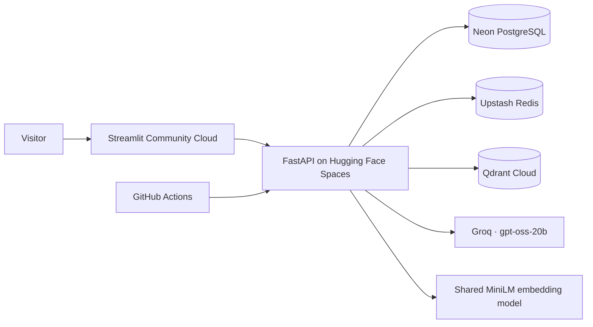

# AI Career Hub

An AI-powered career acceleration platform built with a production-grade engineering stack.
Upload your resume, score it against job descriptions, generate honest cover letters, and track your applications — all in one place.

[](https://github.com/deeason7/ai-career-hub/actions/workflows/pipeline.yml)
[](https://www.python.org/downloads/release/python-3110/)
[](https://fastapi.tiangolo.com/)
[](https://github.com/astral-sh/ruff)
[](./LICENSE)

---

## Live Deployment

| Service | URL |
|---|---|
| **Application** | https://deeason-career.streamlit.app |
| **API health** | https://deeason-careerhub.hf.space/health/warm |

> The demo uses managed free tiers (Streamlit Community Cloud + Hugging Face Spaces + Neon + Upstash + Qdrant Cloud), selected through environment configuration. Availability depends on provider sleep policies and service quotas; see [project status and measured results](docs/PROJECT_STATUS.md).

The same commit also targets a fully scripted **AWS deployment** (EC2 + RDS in a private VPC, ECR images, SSM-driven deploys, wake-on-visit cold starts, business-hours scheduling). That environment is currently **hibernated**: provisioning scripts are retained in [`infra/scripts/`](./infra/scripts). Re-arming requires restoring resources and credentials before enabling the deploy switch. Retained DNS and database backups can incur charges; no current billing total is verified. See [DEPLOYMENT.md](./DEPLOYMENT.md).

---

## Features

| Feature | Description |
|---|---|
| **Multi-Resume Management** | Upload, store, and switch between up to 10 resumes per user (PDF, DOCX, TXT — 5 MB max) |
| **Semantic ATS Scorer** | `sentence-transformers` dense vector similarity + keyword matching + structure heuristics — catches synonym matches that keyword-only ATS systems miss |
| **AI Cover Letter Generator** | Structured LLM generation grounded strictly in resume facts, then honesty-checked by a second model |
| **Cover Letter Refinement** | Apply targeted edit commands to any generated letter; branch a new draft from any point in history; full revision tree with one-click rollback |
| **AI-as-a-Judge QA** | Second LLM pass scores every cover letter for honesty (1–10) and tone (1–10) — auto-regenerates up to 2× if honesty score falls below threshold |
| **Structured LLM Output** | All LLM responses return Pydantic v2-validated JSON via `instructor` — no regex parsing, deterministic contracts |
| **Workflow Orchestration** | Event-driven cover letter pipeline via n8n Cloud webhooks — graceful fallback to local `BackgroundTasks` |
| **PDF Export** | Download generated cover letters as professionally formatted PDFs |
| **Job URL Import** | Auto-fill job description from any LinkedIn, Greenhouse, Lever, or Workday URL |
| **Skill Gap Analysis** | Identify missing skills with AI-powered upskilling recommendations |
| **Live Progress, No Lost Work** | Job-match and the agentic pipeline run as async background tasks (202 + poll); a live step checklist streams progress and survives navigating away mid-run |
| **Rate-Limit Resilience** | LLM calls back off and retry on provider 429s with an honest "model busy" status; the job-match fan-out serialises to fit the token-per-minute budget |
| **Interview Question Generator** | 10 tailored questions generated from your resume and the job description |
| **Application Tracker** | Full pipeline tracking with deadline management and urgency indicators |
| **Auto-Tracker** | Cover letter generation automatically creates a wishlist tracker entry — no manual logging required |
| **Document Lifecycle** | 15-day TTL on resumes and cover letters with expiry badges; nightly cleanup via `/admin/lifecycle/run` |

---

## Architecture

The active deployment separates the frontend, API and managed data services:



Local Docker Compose uses PostgreSQL, Redis, ChromaDB and optional Ollama. The
hibernated AWS topology remains documented in [INFRASTRUCTURE.md](INFRASTRUCTURE.md).
See [ARCHITECTURE.md](docs/ARCHITECTURE.md) for request flows and design decisions.

**Cover letter generation** dispatches to n8n Cloud when configured — falls back to `BackgroundTasks`.
**QA review** runs a second LLM pass scoring honesty and tone — auto-regenerates if below threshold.
**Structured output** via `instructor` + Pydantic v2 — all LLM responses validated before persisting.
**ATS scoring** uses `sentence-transformers` `all-MiniLM-L6-v2` (80 MB, CPU, cached via `lru_cache`).
**Secrets** are configured in Hugging Face Spaces, Streamlit Cloud and GitHub Environments for the active deployment. The AWS target uses SSM Parameter Store. Local environment files are ignored by Git.
**Deployments** are fully automated — a push to `main` runs GitHub Actions, and each target (AWS, free tier) deploys only when its repository-variable switch is armed.

---

## Security & Reliability

| Area | Implementation |
|---|---|
| **Authentication** | JWT (PyJWT, HS256) with `is_active` check on every protected request |
| **Session Management** | Short-lived access tokens + HttpOnly refresh cookie — inaccessible to JavaScript |
| **Rate Limiting** | `slowapi` — registration: 3/min · login: 5/min · refresh: 20/min · AI endpoints: 20/min · cover letters: 5/min · fetch-job: 10/min |
| **Password Hashing** | `bcrypt` — minimum 12 characters enforced at model level |
| **CORS** | Restricted to known origins — no wildcard `*` with credentials |
| **File Uploads** | 5 MB limit · MIME type allowlist (PDF/DOCX/TXT) · filename sanitisation |
| **SSRF Protection** | Job URL import resolves the target host and rejects private, loopback, link-local, and cloud-metadata (IMDS) IPs; each redirect hop is re-validated |
| **Security Headers** | `Content-Security-Policy` (scoped) · `X-Content-Type-Options` · `X-Frame-Options: DENY` · `Referrer-Policy` · `Permissions-Policy` · `Cross-Origin-Resource-Policy` · `Cross-Origin-Opener-Policy` · `X-Permitted-Cross-Domain-Policies` |
| **HSTS** | Enabled in production — 1-year max-age, includeSubDomains |
| **API Documentation** | Hidden when `PRODUCTION=true` |
| **Input Validation** | All request payloads validated by Pydantic v2 — field-level length constraints |
| **Error Monitoring** | Sentry SDK with PII disabled (`send_default_pii=False`) |
| **LLM Output Validation** | `instructor` enforces Pydantic v2 contracts — retries up to 3× on validation failure |
| **Prompt Injection Guard** | Job descriptions stripped of fenced code blocks, chat-template tokens, and override phrases before any LLM call — on both the local and n8n dispatch paths |
| **Webhook Auth** | n8n callback endpoint authenticated via shared secret header |
| **IAM Least Privilege** | Custom scoped policies — no wildcards, no unused permissions |
| **EC2 IMDS** | IMDSv2 required — instance metadata not accessible via SSRF |
| **Secrets Management** | Provider secret stores + GitHub Environments; SSM SecureString on the AWS target |
| **Audit Logs** | PostgreSQL audit records with hashed client IPs; provider logs and optional Sentry |
| **Cost Controls** | Managed free-tier quotas; AWS reference includes budget alerts and automatic stop |
| **Dependency Scanning** | `pip-audit` in CI + Dependabot for weekly pip + monthly GitHub Actions updates |

---

## Tech Stack

| Layer | Technology |
|---|---|
| **Backend API** | FastAPI · SQLModel · Alembic · Python 3.11 |
| **Database** | Neon PostgreSQL (hosted); PostgreSQL 16 in local Docker; RDS in the AWS reference |
| **Cache / Rate Limiting** | Upstash Redis (hosted); Redis 7 in local Docker |
| **AI / LLM** | Groq API (`openai/gpt-oss-20b`); Ollama (local dev) |
| **Structured Output** | `instructor` + Pydantic v2 |
| **AI QA** | AI-as-a-Judge reviewer — honesty/tone scoring with auto-regeneration |
| **Semantic NLP** | `sentence-transformers` — `all-MiniLM-L6-v2` |
| **RAG Pipeline** | Qdrant Cloud (hosted) · ChromaDB (local) · LangChain · shared `all-MiniLM-L6-v2` embeddings |
| **Orchestration** | n8n Cloud (optional webhook-based) — fallback to `BackgroundTasks` |
| **PDF Generation** | `reportlab` — server-side, no headless browser |
| **Web Scraping** | `httpx.AsyncClient` + `beautifulsoup4` |
| **Frontend** | Streamlit |
| **Infrastructure** | Hugging Face Spaces · Streamlit Community Cloud · Docker Compose; scripted AWS reference |
| **AWS reference** | EC2 · RDS · ECR · Lambda · API Gateway · S3 · CloudFront · Route 53 (hibernated) |
| **Scheduling** | GitHub Actions keep-warm and daily cleanup; optional Cloudflare Worker |
| **Observability** | Health probes · GitHub Actions run logs · optional Sentry; CloudWatch on AWS |
| **CI/CD** | GitHub Actions — lint, tests, dependency audit, Space sync and health verification |
| **Code Quality** | ruff (E/F/W/I/B/UP rules) · pre-commit hooks |

---

## API Routes

| Method | Path | Auth | Rate Limit | Description |
|---|---|---|---|---|
| POST | `/api/v1/auth/register` | — | 3/min | Create account |
| POST | `/api/v1/auth/login` | — | 5/min | JWT + refresh cookie |
| POST | `/api/v1/auth/refresh` | Cookie | 20/min | Renew access token |
| POST | `/api/v1/auth/logout` | Cookie | — | Revoke refresh token |
| GET | `/api/v1/auth/me` | JWT | — | Current user profile |
| POST | `/api/v1/resumes/upload` | JWT | — | Upload resume (PDF/DOCX/TXT) |
| GET | `/api/v1/resumes/` | JWT | — | List resumes |
| GET | `/api/v1/resumes/{id}` | JWT | — | Get resume with raw text |
| PUT | `/api/v1/resumes/{id}/activate` | JWT | — | Set active resume |
| DELETE | `/api/v1/resumes/{id}` | JWT | — | Delete resume |
| GET | `/api/v1/resumes/{id}/analysis` | JWT | — | Structured parsed analysis |
| POST | `/api/v1/cover-letters/generate` | JWT | 5/min | Dispatch generation (async 202) |
| GET | `/api/v1/cover-letters/` | JWT | — | List cover letters |
| GET | `/api/v1/cover-letters/task/{task_id}` | JWT | — | Poll generation status |
| GET | `/api/v1/cover-letters/{id}` | JWT | — | Get cover letter |
| GET | `/api/v1/cover-letters/{id}/pdf` | JWT | — | Download PDF |
| POST | `/api/v1/cover-letters/{id}/refine` | JWT | 5/min | Queue targeted refinement (202) |
| GET | `/api/v1/cover-letters/{id}/revisions` | JWT | — | List revision history |
| POST | `/api/v1/cover-letters/{id}/revisions/{v}/activate` | JWT | — | Promote revision to canonical |
| POST | `/api/v1/ai/ats-score` | JWT | 20/min | ATS score against JD |
| POST | `/api/v1/ai/skill-gap` | JWT | 20/min | Skill gap analysis |
| POST | `/api/v1/ai/interview-questions` | JWT | 20/min | Generate interview questions |
| POST | `/api/v1/ai/fetch-job` | JWT | 10/min | Fetch JD from URL |
| POST | `/api/v1/analysis/job-match` | JWT | 20/min | ATS + skill gap + interview in one call (async 202) |
| GET | `/api/v1/analysis/task/{task_id}` | JWT | — | Poll job-match status with live per-step progress |
| POST | `/api/v1/agent/analyze` | JWT | 5/min | Full agentic pipeline from a job URL — async 202 (scrape → research → score → letter → questions) |
| GET | `/api/v1/agent/task/{task_id}` | JWT | — | Poll the agent run with a live step checklist |
| GET | `/api/v1/rag/stats` | JWT | — | Per-user embedding collection stats |
| POST | `/api/v1/rag/search` | JWT | — | Semantic search over indexed documents |
| POST | `/api/v1/rag/reindex` | JWT | — | Rebuild embeddings (async 202) |
| GET | `/api/v1/jobs/` | JWT | — | List job applications |
| POST | `/api/v1/jobs/` | JWT | — | Create application |
| GET | `/api/v1/jobs/stats` | JWT | — | Breakdown by status |
| PATCH | `/api/v1/jobs/{id}` | JWT | — | Update application fields |
| DELETE | `/api/v1/jobs/{id}` | JWT | — | Delete application |
| POST | `/api/v1/admin/lifecycle/run` | Secret header | — | Trigger document cleanup |
| PUT | `/api/v1/webhooks/n8n/cover-letters/{id}/callback` | Webhook secret | — | n8n result callback |
| GET | `/health` | — | — | Liveness check |
| GET | `/health/warm` | — | — | Deep warm-up probe (DB + Redis + vector + semantic model); inspect per-dependency status even on HTTP `200` |

---

## Environment Variables

| Variable | Required | Default | Description |
|---|---|---|---|
| `POSTGRES_SERVER` | ✅ | — | DB host (Docker: `db`) |
| `POSTGRES_USER` | ✅ | — | DB username |
| `POSTGRES_PASSWORD` | ✅ | — | DB password |
| `POSTGRES_DB` | ✅ | — | Database name |
| `POSTGRES_PORT` | — | `5432` | DB port |
| `SECRET_KEY` | ✅ | — | JWT signing key (min 32 chars) |
| `ACCESS_TOKEN_EXPIRE_MINUTES` | — | `60` | Access token lifetime |
| `REDIS_HOST` | — | `redis` | Redis host (blank = in-memory) |
| `REDIS_PORT` | — | `6379` | Redis port |
| `REDIS_PASSWORD` | — | `""` | Redis auth password |
| `GROQ_API_KEY` | — | `""` | Groq API key — takes priority over Ollama when set |
| `GROQ_LLM_MODEL` | — | `openai/gpt-oss-20b` | Groq model ID |
| `OLLAMA_BASE_URL` | — | `http://ollama:11434` | Ollama endpoint (local dev) |
| `OLLAMA_LLM_MODEL` | — | `llama3.2:3b` | Ollama LLM model |
| `OLLAMA_EMBED_MODEL` | — | `nomic-embed-text` | Ollama embedding model |
| `CHROMA_PERSIST_DIR` | — | `/app/chroma_data` | ChromaDB persistent vector-store path (RAG) |
| `N8N_WEBHOOK_URL` | — | `""` | n8n Cloud trigger URL |
| `N8N_WEBHOOK_SECRET` | — | `""` | Shared secret for n8n callbacks |
| `ALLOWED_ORIGINS` | — | `http://localhost:8501` | Comma-separated CORS origins |
| `BASE_URL` | — | `http://localhost:8000` | Public API base URL (used in n8n callbacks) |
| `PRODUCTION` | — | `false` | Set `true` to hide `/docs` and enable HSTS |
| `TESTING` | — | `false` | Set `true` in CI to disable rate limiting |
| `SENTRY_DSN` | — | `""` | Sentry project DSN (opt-in) |
| `ADMIN_SECRET` | — | `""` | Required to call `/admin/*` endpoints |

---

### Prerequisites

- Docker & Docker Compose
- A free [Groq API key](https://console.groq.com)

### 1. Clone

```bash
git clone https://github.com/deeason7/ai-career-hub.git
cd ai-career-hub
```

### 2. Configure environment

```bash
cp backend/.env.example backend/.env
# Edit backend/.env — minimum required fields:
#   POSTGRES_USER, POSTGRES_PASSWORD, POSTGRES_DB
#   GROQ_API_KEY=gsk_...
#   SECRET_KEY=$(python3 -c "import secrets; print(secrets.token_hex(32))")
```

### 3. Start

```bash
docker compose up --build
```

### 4. Access

| Service | URL |
|---|---|
| Frontend | http://localhost:8501 |
| API (Swagger) | http://localhost:8000/docs |
| Health | http://localhost:8000/health |

> **Embedding model:** the production image includes `all-MiniLM-L6-v2`. Local development may download it on first use; subsequent requests share the in-memory model. Verify semantic scoring separately from vector-store connectivity.

### 5. Developer tooling

```bash
# Install dev dependencies
pip install -r backend/requirements.dev.txt

# Install pre-commit hooks
pre-commit install

# Lint and format
ruff check backend/ frontend/
ruff format --check backend/ frontend/

# Run tests
make test
```

---

## Branch Strategy

| Branch | Purpose | Merges to |
|---|---|---|
| `main` | Production — protected | — |
| `develop` | Integration — all work lands here first | `main` via release PR |
| `feat/*` | New features | `develop` |
| `fix/*` | Bug fixes | `develop` |
| `hotfix/*` | Critical production fixes | `main` + `develop` |

```bash
git checkout develop && git pull origin develop
git checkout -b feat/my-feature
# ... work, commit ...
git push origin feat/my-feature
# Open PR: feat/my-feature → develop
```

---

## Testing

```bash
make test     # isolated careerhub_test database; no live LLM calls
make lint     # backend and frontend checks
make evals    # real embedding model against the labeled offline corpus
```

Test coverage: auth, resume upload, ATS scoring, job tracker CRUD, LLM schema validation, instructor client, QA service review logic, n8n webhook callback.

> Rate limiting is automatically disabled in CI via `TESTING=true`.

---

## Deployment costs and availability

The demo targets free service plans; this is an infrastructure choice, not a measured
billing or uptime guarantee. The backend, frontend and data services have separate
sleep policies. GitHub Actions runs periodic health probes and daily document cleanup;
its schedule must remain enabled. A Cloudflare Worker alternative is included under
[`infra/keep-warm/`](infra/keep-warm/).

AWS compute is hibernated. Retained Route 53 zones and database snapshots may still
cost money, so use the billing console before quoting savings. The re-armable AWS
architecture and its business-hours/wake-on-visit controls are documented in
[DEPLOYMENT.md](DEPLOYMENT.md) and [INFRASTRUCTURE.md](INFRASTRUCTURE.md).

---

## Release History

> The complete, versioned history is maintained in **[CHANGELOG.md](./CHANGELOG.md)**.

### v4.4.3 — Model Packaging and Scoring Evals
- **Embedding model packaged in the image** — the image pins the sentence-transformers cache to a writable path and includes the weights. The post-release live smoke still reported keyword-only fallback; successful model loading in production remained an open issue
- **Boilerplate no longer moves a score** — EEO statements and benefits lists were stripped before keyword matching but not before semantic scoring; both channels now score the same cleaned posting
- **An offline eval harness** (`backend/evals/`) — measures the scorer against a labeled corpus of resume/job pairs: ranking separation, monotonicity when a required skill is added, invariance to presentation changes, and a check that the semantic channel is active; `make evals` prints a scorecard

### v4.4.2 — Reliable Document Cleanup
- **Deletes cascade properly** — resumes and cover letters now remove their child rows instead of trying to orphan them; because both child foreign keys are `NOT NULL`, the ORM's default detach-the-children behaviour made every such delete fail
- **The nightly TTL cleanup works again** — it had failed on every run since the first documents reached their 15-day expiry, and a rolled-back delete meant the same rows re-failed the next night
- **Resume deletion fixed** — `DELETE /resumes/{resume_id}` returned HTTP 500 for any resume with a cover letter attached
- **Diagnosable failures** — the lifecycle endpoint names the failing exception class and logs the traceback, and the keep-warm workflow keeps the response body in its run log

### v4.4.1 — Fail-Open Rate Limiting & Switchable Deploy Targets
- **Rate limiting fails open** — if the limiter's Redis storage dies, it degrades to in-memory counting instead of raising on every decorated route; a dead Redis used to 500 login and register while `/health` stayed green
- **Real client IPs behind proxies** — uvicorn trusts `X-Forwarded-For` and nginx sends `$remote_addr`, so per-IP limits and hashed audit IPs key on the visitor, not the proxy hop
- **Per-target deploy switches** — the AWS deploy is gated by an `AWS_DEPLOY_ENABLED` repository variable (mirroring `FREE_DEPLOY_ENABLED`) and the pipeline supports manual dispatch, so either target can be paused or re-armed without editing the workflow
- **Verified free-tier deploys** — the deploy job waits for the Space rebuild and requires a healthy `/health/warm` before reporting success
- **Groq model refresh** — the default model is now `openai/gpt-oss-20b`, ahead of `llama-3.1-8b-instant`'s 2026-08-16 decommissioning

### v4.4.0 — Guided Product Tour & Landing Showcase
- **Guided product tour** — a Back/Next rail that walks every page in journey order (Home → Resumes → Job Match → Cover Letter → Tracker → Quick Apply), seeds a sample job description, and restarts from the sidebar; Home offers it to first-time visitors
- **Animated landing showcase** — the sign-in screen tells the whole product story in pure CSS (ATS gauge, judged cover letters, the agentic pipeline, the tracker), with scroll-driven reveals where the browser supports them
- **App-wide visual refresh** — a shared theme layer, score rings, a live agent-pipeline strip, and a QA-judge stamp across the analysis views
- **Scrape transparency** — the agent surfaces what it actually read from a posting, with a warning when a login wall left the scrape thin

### v4.3.2 — Observability & Resilience Hardening
- **Richer health signals** — `/health/warm` reports `db` and `redis` as `{status, detail}` with the failing exception, and `VECTOR_BACKEND` is validated at startup with the probe naming the store actually selected (a typo fails fast instead of silently falling back)
- **Self-healing connections** — shared Redis clients re-check connections idle over 30s (`health_check_interval`) so provider-reaped sockets reconnect instead of failing the next command; an unreachable Redis surfaces as a boot-time warning
- **Quieter alerting** — the keep-warm probe retries before emailing, so a single-sample idle blip no longer pages
- **Sturdier AI + UI** — resume parsing runs through the same schema-validated path as the other AI features, and the Resumes page degrades to an honest retry state when the backend is cold instead of crashing
- **Dependency refresh** — `qdrant-client` 1.18.0 to match the managed cluster

### v4.3.1 — Single-Database Redis Support
- **Managed-Redis compatibility** — the task-store and token-deny-list clients pin logical DBs `2`/`1` on a real Redis; `REDIS_DB_TASKS` / `REDIS_DB_DENYLIST` now override them for single-database providers like Upstash
- **Hardened connection URLs** — Redis passwords are percent-encoded in every connection URL, so special characters can't corrupt the parse

### v4.3.0 — Managed-Provider Portability
- **Pluggable vector store** — `VECTOR_BACKEND=qdrant` selects a Qdrant Cloud backend alongside the default ChromaDB: one shared collection, a mandatory per-user payload filter, deterministic point ids for idempotent re-embedding
- **TLS options for hosted datastores** — `DB_SSLMODE` (Neon) and `REDIS_SSL` (Upstash `rediss://`)
- **`GET /health/warm`** — a deep warm-up probe touching Postgres, Redis and the vector store; always `200` with per-dependency status
- **Free-tier CD** — a `deploy-free` pipeline job ships the backend to a Hugging Face Space from the same `main` commit as the AWS deploy, gated by a `free-prod` GitHub Environment
- **Dependency refresh** — langchain-core / langgraph 1.x migration (Ollama fallback on `langchain-ollama`), plus cryptography, faiss-cpu, mypy and actions bumps

### v4.2.0 — Async Analysis, Resilience & Refine Branching
- **Async job-match & agentic analysis** — both now return `202` and run as background tasks with a Redis-backed task store; the UI polls and renders a live step checklist that survives navigating away mid-run
- **LLM rate-limit resilience** — capped exponential backoff on provider `429`s with an honest "model busy" status; the job-match fan-out is serialised to fit the token-per-minute budget
- **ATS keyword quality** — posting boilerplate (EEO, benefits) is stripped before extraction, so matched and missing keywords read like real skills
- **Refine from any revision** — branch a new draft off any past version, with lineage tracked through the revision tree (migration `011`)
- **Session restore** — a bounded wait-for-hydration gate keeps you logged in across reload and duplicate tabs

### v4.1.0 — Agentic Pipeline, RAG & Release Hardening
- **Agentic analysis pipeline** (LangGraph): one job URL drives scrape → company research → ATS score → skill-gap → cover letter → interview questions in a single run (`POST /api/v1/agent/analyze`)
- **Retrieval-augmented generation** (ChromaDB): persistent per-user vector collections; resumes auto-embed on upload, cover letters and job descriptions are indexed after generation, with a FAISS fallback (`/api/v1/rag/stats` · `/search` · `/reindex`)
- **Prompt-injection guard broadened**: role labels matched at any line start, LLaMA 3 chat-template tokens, and "ignore previous instructions" override phrases — applied on both the local and n8n dispatch paths
- **Content-Security-Policy scoped** so the strict `default-src 'none'` no longer breaks the API docs in development
- **Constant-time secret comparison** (`hmac.compare_digest`) for the admin and n8n webhook shared secrets
- **SSRF hardening** on job-URL import: resolve and validate the target host IP, reject private/loopback/link-local/metadata ranges, and re-validate every redirect hop
- **Stuck-generation reaper**: a `started_at` timestamp plus a watchdog that fails cover letters orphaned in `processing` by a restart or instance sleep
- **Concurrency & validation fixes**: refinement version numbers assigned under a row lock; generation poll returns 404 for unknown/expired tasks; job-description minimum length enforced
- **Frontend resilience**: access-token refresh on 401 to prevent silent logouts, dashboard cold-start handling with honest error states, and login/register timeouts
- Widened the `alembic_version` column so a fresh-from-empty migration run succeeds

### v4.0.2 — Code Cleanup + Security Hardening
- Consolidated comments and multi-line docstrings to concise one-line summaries across 7 backend files
- Password minimum raised from 8 to 12 characters
- Three new security headers: `X-Permitted-Cross-Domain-Policies`, `Cross-Origin-Resource-Policy`, `Cross-Origin-Opener-Policy`
- Audit log expanded: `auth.register` and `auth.login.failed` events now captured (brute-force detection)
- Prompt injection regex expanded to cover LLaMA 2 / Mixtral delimiters: `[INST]`, `[/INST]`, `<<SYS>>`, `<</SYS>>`, `<|im_end|>`
- New test files: `test_security_headers.py`, `test_password_policy.py`

### v4.0.1 — Auth Fix + Branch Sync
- Fixed `verify_token` tuple unpack in `deps.py` (`AttributeError` in production)
- Synced `develop` with `main` (was 5 commits behind after v4.0.0)
- 7 frontend bugs fixed: cookie TypeError crash, sidebar visible to guests, logout token revocation, PDF N+1 requests, 502 crash, register hint, yellow component banner

### v4.0.0 — OWASP Hardening, Auto-Tracker, Refinement System & Modular Frontend
- 15-day document lifecycle management with expiry badges and nightly cleanup (F1)
- Application tracker auto-populated from cover letter generation via LLM metadata extraction (F4)
- Cover letter refinement system: targeted edit commands, full revision history, one-click rollback (F4)
- OWASP A03/A07/A09 hardening: prompt injection sanitization, rate limiting, audit logging with SHA-256 IP hashing (F5)
- SSRF protection: `AnyHttpUrl` enforcement on job URL import endpoint (F5)
- Dependency scanning via `pip-audit` in CI (F5)
- Streamlit frontend refactored from a 1235-line monolith into a modular `pages/` architecture (F6)
- Dark mode toggle, toast notifications, shared `components.py` utility layer (F6)

### v3.0 — Structured Output & Orchestration
- Structured LLM output via `instructor` + Pydantic v2 (typed schemas, validated contracts)
- AI-as-a-Judge QA layer — honesty/tone scoring with auto-regeneration (up to 2× retries)
- n8n Cloud workflow orchestration — event-driven webhooks with graceful fallback
- Automated CD: GitHub Actions → ECR → EC2 SSM

### v2.6 — Business Hours Scheduler
- EventBridge Scheduler: start 9 AM / stop 6 PM ET, Mon–Fri
- Pre-commit hooks: ruff lint+format + file hygiene
- CI: ruff check + format + pytest in GitHub Actions

### v2.5 — Performance & Reliability
- Lambda EC2+RDS status checks parallelised (~400ms vs ~1.3s)
- gzip compression on nginx for JS/CSS/JSON
- Streamlit starts on `service_started` — earlier warm-up
- Wake page: DNS poll + manual button fallback

### v2.0 — AWS Production Deployment
- Migrated from Render/Supabase to AWS EC2 + RDS
- Celery replaced with FastAPI `BackgroundTasks`
- Secrets managed via AWS SSM Parameter Store
- Wake-on-Visit infrastructure (Route 53 failover → CloudFront → Lambda)
- Hardened IAM — least-privilege policies, MFA, IMDSv2

---

## Documentation

| Document | Contents |
|---|---|
| [Architecture](./docs/ARCHITECTURE.md) | System design, request lifecycle, the async task model, the agentic pipeline, and the data model — with diagrams |
| [API Reference](./docs/API.md) | Every endpoint: auth, rate limits, request/response shapes, and status codes |
| [Configuration](./docs/CONFIGURATION.md) | Full environment-variable reference |
| [Architecture Decisions](./docs/adr/) | The reasoning behind the load-bearing design choices (ADRs) |
| [Changelog](./CHANGELOG.md) | Complete release history |
| [Contributing](./CONTRIBUTING.md) · [Security](./SECURITY.md) | Workflow, conventions, and the security policy |
| [Deployment](./DEPLOYMENT.md) · [Infrastructure](./INFRASTRUCTURE.md) | AWS topology, CI/CD, and the cost model |

---

## Contributing

1. Fork → `git checkout -b feat/your-feature`
2. Install hooks: `pre-commit install`
3. Follow conventional commits: `feat(scope): description`
4. Open PR to `develop`

---

## License

MIT © 2026 [deeason7](https://github.com/deeason7)

---

## Disclaimer

> This project is for educational and portfolio demonstration purposes.

AI-generated content is not professional career advice. Always review outputs before use in real applications. The author makes no warranties regarding accuracy, reliability, or fitness for any purpose. Use at your own discretion.

---

## Privacy Notice

| Platform | Role | Privacy Policy |
|---|---|---|
| Hugging Face | Backend hosting | [huggingface.co/privacy](https://huggingface.co/privacy) |
| Streamlit Community Cloud | Frontend hosting | [streamlit.io/privacy-policy](https://streamlit.io/privacy-policy) |
| Neon | Account and application database | [neon.com/privacy-policy](https://neon.com/privacy-policy) |
| Upstash | Task state and token revocation | [upstash.com/trust/privacy.pdf](https://upstash.com/trust/privacy.pdf) |
| Qdrant Cloud | Document embeddings and retrieval | [qdrant.tech/legal/privacy-policy](https://qdrant.tech/legal/privacy-policy/) |
| AWS (hibernated reference) | Optional hosting and retained backups | [aws.amazon.com/privacy](https://aws.amazon.com/privacy/) |
| Groq | AI inference | [groq.com/privacy-policy](https://groq.com/privacy-policy/) |

**What is stored:** Account email (hashed password), full name, extracted resume text, cover letters, ATS scores, application records.

**What is not stored:** Raw uploaded files · payment information · tracking data beyond session cookies.

> Do not upload documents containing government IDs, financial account numbers, or other high-sensitivity personal data to the public demo. For sensitive data, self-host using the Docker Compose setup.
