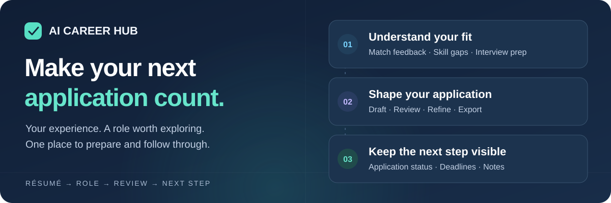
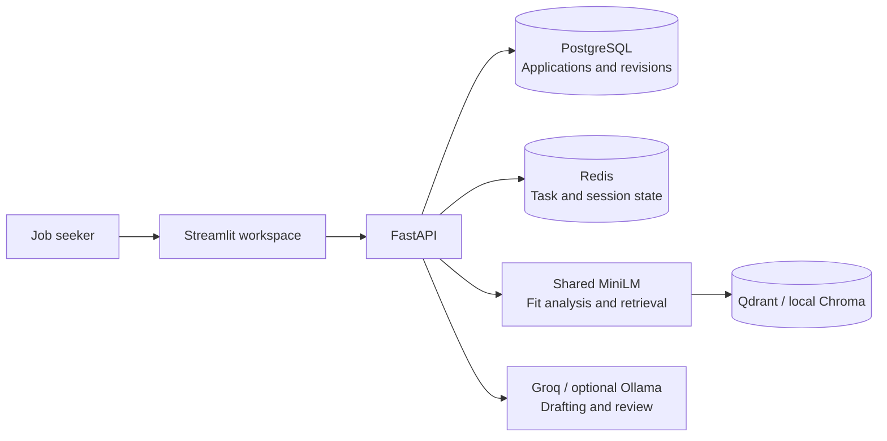

# AI Career Hub

**Know where you fit. Tell your story. Keep your applications moving.**

A job-application workspace for turning your résumé and a job posting into
fit feedback, a cover letter you can review and refine, interview preparation,
and a record of what to do next.

[**Try the demo →**](https://deeason-career.streamlit.app) ·
[Walk through an application](#try-your-first-application) ·
[Run locally](#run-locally) · [Explore the docs](docs/README.md)

[](https://github.com/deeason7/ai-career-hub/actions/workflows/pipeline.yml)
[](LICENSE)

## One workspace, three useful outcomes

Applying involves more than generating a letter: you need to understand the role,
choose relevant experience, check the draft, and remember the next action.
AI Career Hub brings those tasks together.

| Understand your fit | Prepare material you can review | Follow through |
|---|---|---|
| Compare your résumé with a posting using semantic, keyword, and structure feedback. Explore skill gaps and interview questions. | Generate a saved cover letter using résumé context, inspect AI review feedback, refine specific passages, and export a PDF. | Saved letter generation creates a wishlist entry. Manage application status, deadlines, and notes in the tracker. |

You make the final edits and submit through the employer's application process.
The fit score is preparation guidance; the AI review helps flag issues for you to check.

## Try your first application

1. **Open the [demo](https://deeason-career.streamlit.app) and create an account.**
   If Streamlit shows a sleep page, use its wake button and wait for the workspace.
2. **Upload a résumé in Resumes.** PDF, DOCX, and TXT are supported, up to 5 MB.
   The [synthetic Python résumé](backend/evals/datasets/resumes/backend_python.txt)
   is ready to download as a `.txt` file if you want to explore without personal data.
3. **Open Job Match and paste a posting.** Use the guided tour's sample job, or this
   [sample Python role](backend/evals/datasets/jobs/python_backend.txt).
   Review the score breakdown, skill gaps, and interview questions.
4. **Create a saved draft in Cover Letters.** Review its claims and QA feedback,
   try a targeted refinement, then export the version you want as a PDF.
5. **Open Tracker.** Check the automatically created entry and set its next status,
   deadline, or notes. If automatic extraction failed, add the application manually.

**Have a job URL?** Quick Apply runs seven analysis steps, including company research
and a draft. Its draft currently remains separate from saved letters, QA, PDF export,
and the tracker. Connecting those paths is the [first planned refactoring](docs/REFACTORING_PLAN.md#1-connect-quick-apply-to-a-saved-application).
Use Job Match and Cover Letters for the saved workflow above; a pasted posting also
works when a job site blocks fetching.

## What has been verified

| Evidence | Result | Scope |
|---|---|---|
| Application workflow | Upload → match → saved letter → refinement → PDF → tracker | Deployed synthetic API journey, 2026-10-26; browser interactions remain to be checked |
| Regression checks | **451 passed**, 8 expected live-LLM failures | 359 backend, 63 frontend, 29 maintenance checks, 2026-10-27 |
| Scoring evaluation | **7/7 gates passed across 20 pairs** | Real MiniLM model in the production image with networking disabled, 2026-10-27 |
| Consistent fit feedback | Irrelevant posting boilerplate caused **0 points of drift**, down from 3.5 | Controlled synthetic benchmark; reproduced in the current image |

The latest release is **v4.4.3**. Recovery and housekeeping updates in this branch
are **unreleased**. See the [checkpoint](docs/CHECKPOINT.md) and
[verified status](docs/PROJECT_STATUS.md) for remaining release checks.

Preparation time, review effort, and completion rate are the next product measurements.
The [measurement plan](docs/PRODUCT.md#measuring-user-value) defines a manual baseline;
user adoption, time savings, and hiring improvements have not been established.

## Run locally

You need Docker with Compose. Clone the repository and create your local settings:

```bash
git clone https://github.com/deeason7/ai-career-hub.git
cd ai-career-hub
cp backend/.env.example backend/.env
```

Edit `backend/.env`: choose local database credentials, replace `SECRET_KEY` with
an independently generated value, and either add a Groq key or leave it blank for
Ollama. The [setup guide](CONTRIBUTING.md#running-locally) covers each setting.

```bash
docker compose --env-file backend/.env up --build -d
```

For **Ollama**, download its models after the service starts:

```bash
docker compose exec ollama ollama pull llama3.2:3b
docker compose exec ollama ollama pull nomic-embed-text
```

Open [the workspace](http://localhost:8501) or [local API docs](http://localhost:8000/docs).
The first build/model download needs internet access. `--env-file` keeps the database
container and API settings aligned; see [local setup and troubleshooting](CONTRIBUTING.md#running-locally).

For verification, use the [test commands](CONTRIBUTING.md#run-tests), including the
credential override when your local database differs from Compose's test defaults.

## Under the hood



The demo uses Streamlit Community Cloud, Hugging Face Spaces, Neon, Upstash, and
Qdrant. LangGraph coordinates Quick Apply; Instructor validates structured model
responses. Docker, GitHub Actions, regression tests, and scoring evaluations support
delivery. The retained AWS target is deprovisioned and requires restoration before use.

See [architecture](docs/ARCHITECTURE.md) for the request flows and design tradeoffs.

## Your data and your judgment

The hosted demo sends résumé text and job descriptions to Groq for generation and
uses hosted storage for records and document embeddings. Start with synthetic data;
review every generated claim before using a draft. The app's **Legal & Info** page
and [security policy](SECURITY.md) explain retention, deletion limits, and safeguards.

## Explore the project

| I want to… | Start here |
|---|---|
| Understand the product and its business value | [Product brief](docs/PRODUCT.md) |
| See what works and what comes next | [Verified status](docs/PROJECT_STATUS.md) · [Refactoring plan](docs/REFACTORING_PLAN.md) |
| Run, contribute to, or integrate the project | [Contributing](CONTRIBUTING.md) · [API reference](docs/API.md) |
| Deploy or troubleshoot availability | [Deployment and recovery](DEPLOYMENT.md) |
| Browse every guide | [Documentation map](docs/README.md) |

## Release History

> The complete, versioned history is maintained in **[CHANGELOG.md](./CHANGELOG.md)**.

### v4.4.3 — Scoring quality and evaluation

- **More consistent résumé feedback** — semantic and keyword scoring use the same
  job text after removing employer boilerplate.
- **Repeatable quality checks** — seven scoring checks run against 20 labeled pairs;
  the released image downloads embedding weights during its build. The unreleased
  checkpoint adds an explicit model directory and offline inference verification.

## License

[MIT](LICENSE) © 2026 [deeason7](https://github.com/deeason7).
