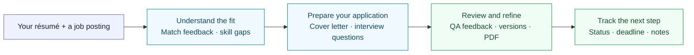

# AI Career Hub

**Turn a résumé and a job posting into an application you can review, refine, and track.**

AI Career Hub helps job seekers assess a role, prepare tailored application material,
and keep the next action visible. It brings résumé feedback, cover-letter drafting,
interview preparation, and application tracking into one workspace.

[**Open the demo →**](https://deeason-career.streamlit.app) ·
[Product and value](docs/PRODUCT.md) · [Verified status](docs/PROJECT_STATUS.md) ·
[Documentation](docs/README.md)

[](https://github.com/deeason7/ai-career-hub/actions/workflows/pipeline.yml)
[](LICENSE)

## From a posting to a prepared application



| What you need to do | What the workspace provides |
|---|---|
| Decide how your experience fits a role | Semantic, keyword, and résumé-structure feedback, with skill-gap recommendations |
| Write a relevant application | A cover-letter draft using résumé context and the job description, followed by an AI honesty/tone review |
| Make the draft your own | Targeted edits, version history, and PDF export from the saved cover-letter workflow |
| Prepare for a conversation | Interview questions based on your experience and the role |
| Keep applications organized | Automatic wishlist entries after saved letter generation, plus statuses, deadlines, and notes |

Upload a résumé, then use **Job Match** and **Cover Letters** for the saved application
workflow. **Quick Apply** runs a seven-step analysis from a public job URL, including
company research and a draft. Its results currently remain separate from saved
letters, QA review, and tracking; connecting those paths is a planned improvement.

You review the material and submit the application yourself. Match scores are
preparation guidance, not predictions of an employer's screening decision.

## What has been demonstrated

- **The deployed application workflow works through the API.** On 2026-10-26, a
  synthetic résumé was parsed and scored, a letter generated and refined, its PDF
  exported, and an automatically created application updated in the tracker.
- **Résumé feedback is less sensitive to irrelevant posting text.** The recorded
  offline evaluation reduced boilerplate-driven score movement from **3.5 to 0
  points across 20 labeled résumé/job pairs**.
- **Productivity impact is the next measurement.** Preparation time, completion
  rate, editing effort, and hiring outcomes have not been measured. The
  [product brief](docs/PRODUCT.md#measuring-user-value) defines the baseline and
  acceptance criteria before those claims are made.

See [project status](docs/PROJECT_STATUS.md) for dates, test scope, and remaining
release checks. A passing workflow badge alone does not establish live availability.

## Try it

Open the [hosted demo](https://deeason-career.streamlit.app), create an account,
and follow the guided tour. Use a synthetic résumé when exploring the public demo.
A sleeping Streamlit app may display a wake button before the workspace opens.
[Recovery instructions](DEPLOYMENT.md#readiness-and-incident-recovery) cover the
frontend and API separately.

Résumé text and job descriptions are sent to Groq for generation; application
records and document embeddings use hosted storage. Avoid uploading sensitive
identifiers. The app's **Legal & Info** page explains data handling and retention;
[SECURITY.md](SECURITY.md) describes safeguards and known limitations. Generated
claims and QA verdicts require your review.

## Run locally

Use Docker Compose and choose either Groq or local Ollama for generation.

```bash
git clone https://github.com/deeason7/ai-career-hub.git
cd ai-career-hub
cp backend/.env.example backend/.env
```

Set the database values to match your local Compose configuration, generate a
unique `SECRET_KEY`, and configure the model provider. Follow the
[local setup guide](CONTRIBUTING.md#running-locally) and
[configuration reference](docs/CONFIGURATION.md), then start the stack:

```bash
docker compose up --build
```

Open the [frontend](http://localhost:8501) or
[development API documentation](http://localhost:8000/docs).

```bash
make test     # backend regression suite in an isolated test database
make lint     # backend and frontend lint/format checks
make evals    # real embedding model against the labeled scoring corpus
```

## How it is built

| Responsibility | Implementation |
|---|---|
| Workspace and API | Streamlit · FastAPI · Pydantic · SQLModel |
| Application records and task state | PostgreSQL · Redis · Alembic |
| Drafting and review | Groq · instructor · résumé retrieval · optional local Ollama |
| Match feedback | Shared MiniLM embeddings · keyword matching · structure heuristics |
| Guided job analysis | LangGraph workflow with visible step progress |
| Delivery | Docker · GitHub Actions · regression tests · scoring evaluations |

The active demo runs on Streamlit Community Cloud, Hugging Face Spaces, Neon,
Upstash, and Qdrant. An AWS deployment remains a hibernated reference. See
[architecture](docs/ARCHITECTURE.md) for request flows and tradeoffs, and
[deployment](DEPLOYMENT.md) for operating instructions.

## Documentation

| Start here | Continue here |
|---|---|
| [Product brief and value measurement](docs/PRODUCT.md) | Audience, workflow, product boundaries, and outcome definitions |
| [Project status](docs/PROJECT_STATUS.md) | Released behavior, verified evidence, and outstanding checks |
| [Documentation map](docs/README.md) | API, configuration, security, deployment, and design decisions |
| [Contributing](CONTRIBUTING.md) | Setup, development conventions, and verification commands |

## Release History

> The complete, versioned history is maintained in **[CHANGELOG.md](./CHANGELOG.md)**.

### v4.4.3 — Scoring quality and evaluation

- **More consistent résumé feedback** — semantic and keyword scoring use the same
  job text after removing employer boilerplate.
- **Repeatable quality checks** — seven scoring checks run against 20 labeled pairs;
  the image includes the embedding weights.

## License

[MIT](LICENSE) © 2026 [deeason7](https://github.com/deeason7).
