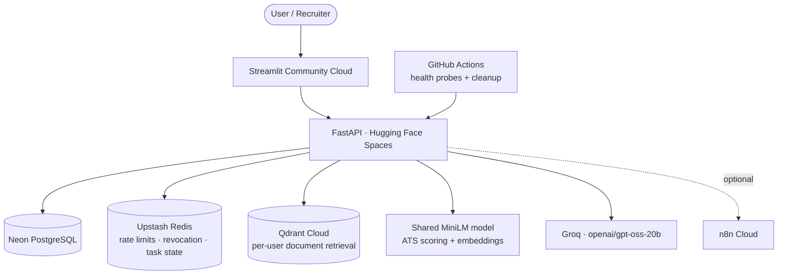
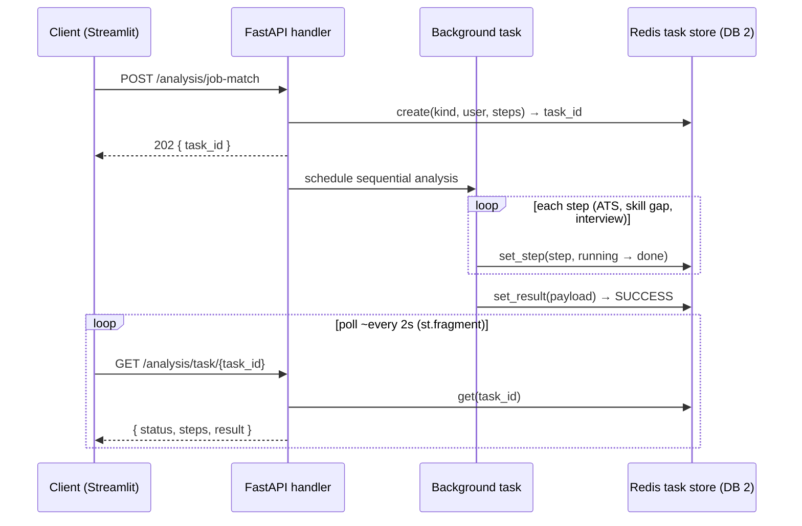
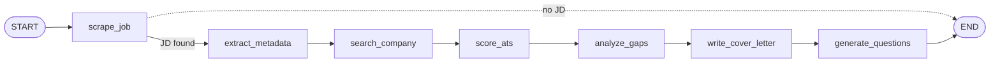
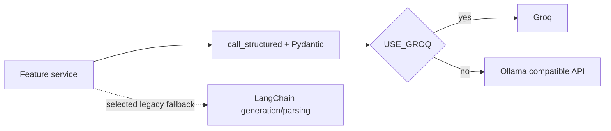
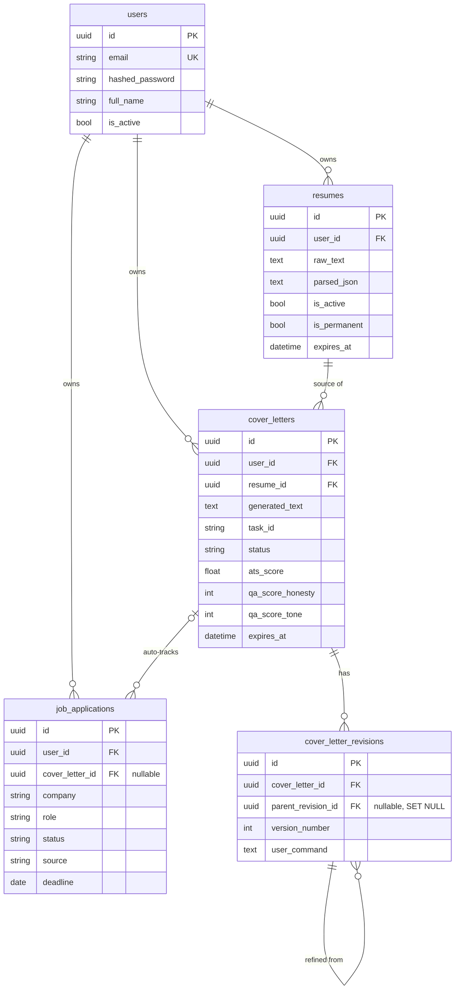

# Architecture

AI Career Hub is a production-deployed FastAPI + Streamlit application that turns a resume and a job
posting into fit guidance, a reviewable cover letter, interview preparation and application tracking.
Quick Apply assembles analysis and a transient draft from a URL; the saved-letter workflow separately
provides model QA, revisions, PDF export and automatic tracker creation. These paths are not yet unified.

This document covers the system topology, the request models (synchronous and async), the agentic
pipeline, the dual-path LLM design, the retrieval layer, and the data model. For the "why" behind the
load-bearing choices, see the [Architecture Decision Records](./adr/).

---

## System context

The active deployment uses managed free tiers. PostgreSQL retains application records,
Redis holds short-lived task and authentication state, and Qdrant retains document
embeddings outside the backend's ephemeral filesystem. The vector store and the
embedding model are separate dependencies: a healthy Qdrant connection does not prove
that semantic scoring works.

Local Docker Compose runs the same application with PostgreSQL, Redis, ChromaDB and
optional Ollama (`llama3.2:3b`). The AWS target is hibernated; its EC2/RDS, nginx,
wake-on-visit and scheduling design remains in [INFRASTRUCTURE.md](../INFRASTRUCTURE.md).
See [project status](PROJECT_STATUS.md) for verification limits and the current work.

---

## Request models

### Synchronous requests

Most endpoints are ordinary `async def` handlers: validate the request with a Pydantic/SQLModel schema,
use an async database session, and return a typed response or a documented dictionary. SQLModel
parameterizes queries. Migrations and some threadpool background tasks use the separate sync engine;
async request handlers do not imply that every operation or database connection is asynchronous.

### Asynchronous work: 202 + poll

Combined job-match analysis and the agent pipeline normally return **`202 Accepted`** with a
`task_id`, execute in the API process, and publish progress to Redis. The client can navigate and poll
again while state remains available. A process restart can interrupt work: this is not a durable worker queue.

The task store (`services/task_state.py`) is deliberately shaped:

- **One Redis hash per task**, with **one field per step** (`step:<name>`). Step writers each flip
  their own step, so there is no read-modify-write race on a shared JSON blob.
- **Statuses** progress `PENDING → STARTED → SUCCESS | FAILURE`; the result payload is stored as JSON on
  completion. A one-hour TTL bounds retention; expired runs cannot be resumed from this store.
- **Two clients.** The async client serves request handlers; a **sync** client serves threadpool writers,
  because FastAPI `BackgroundTasks` run sync functions in worker threads and the async client is bound to
  the event loop. Both are lazily initialised.
- **Degrade to inline.** If Redis can't take the task (`create` returns `None`), the caller runs the work
  inline and returns a normal `200` — the feature still works, it just loses live progress.

A poll for an unknown or expired `task_id` returns `404` (honest "lost"), and a store error surfaces as
`503` rather than a misleading `PENDING`.

Saved cover-letter generation instead stores status and output in PostgreSQL and dispatches to
FastAPI background work or optional n8n. Its poll maps `processing` to `STARTED`, `success` to
`SUCCESS`, and `failure` to `FAILURE`. Refinement returns a revision ID, not a task ID; the client
polls revision QA fields. A failed refinement can leave its previous-text placeholder unresolved.
SQL persistence records state but does not restart interrupted work. See [API contracts](API.md#asynchronous-jobs).

---

## The agentic pipeline

The agent (`services/agent_graph.py`) is a compiled **LangGraph** state graph: one job URL drives a
seven-step pipeline, each step a tool node that reads and writes a shared, typed `AgentState`.

Design points:

- **Typed accumulating state.** `AgentState` is a `TypedDict`; `steps_completed` and `errors` use an
  `operator.add` reducer, so each node *appends* its record rather than overwriting — the full execution
  trace assembles itself.
- **Fail-soft.** If scraping yields no job description, a conditional edge ends the run early. Every other
  node captures its own exception into `errors` and execution continues, so one flaky step never aborts
  the pipeline. The run is reported as `completed`, `partial`, or `failed`.
- **Streaming for progress.** `run_agent` iterates `graph.stream(stream_mode="values")` instead of a
  single `invoke()`. The final state is identical, but each completed node yields once, and an optional
  `on_step` callback turns those yields into the live step checklist the UI renders.
- The compiled graph is a module singleton, built once on first use.

---

## Dual-path LLM

The provider is selected by `USE_GROQ` (derived from the configured Groq key).
The shared `call_structured()` client uses Instructor with Pydantic schemas for
both Groq and Ollama's OpenAI-compatible endpoint.

Feature services also retain older LangChain paths; fallback behavior is defined
at the call site, not as a universal Groq-to-Ollama switch. Schema validation ensures
output shape and field constraints. It cannot establish that a candidate's claim is
true. The saved-letter pipeline adds an LLM honesty/tone review and regeneration;
independent human calibration remains outstanding.

The structured client retries provider rate limits with capped backoff and exposes
`LLMRateLimitedError` when exhausted. Selected callers preserve the busy signal
instead of hiding it behind fallback. Job descriptions are sanitized on supported
prompt paths; this reduces recognizable instruction wrappers but does not eliminate
prompt-injection risk. See [Security](../SECURITY.md).

---

## ATS scoring

The scorer (`services/ats_scorer.py`) is a hybrid model, not keyword-only:

| Signal | Weight | What it measures |
|---|--:|---|
| Semantic | 50% | `all-MiniLM-L6-v2` cosine similarity (whole-document and per-section) — catches synonyms a keyword scan misses |
| Keyword | 30% | Exact matches, bigrams, and a priority-keyword bonus, after boilerplate stripping |
| Structure | 20% | Section-presence heuristics (experience, education, skills…) |

The sentence-transformers model (~80 MB) is loaded **once** via `@lru_cache` and shared with the embedding
service, so the whole process holds a single copy in memory. If model inference is
unavailable, weights become semantic/keyword/structure `0/0.8/0.2`; a valid zero similarity
retains `0.5/0.3/0.2`. The response and UI expose the active weights. Word-count suggestions
are recommendations, not a penalty in the section-presence structure score. These scores
compare content signals, not hiring probability or an employer ATS decision.

---

## Retrieval (RAG)

The embedding service (`services/embedding_service.py`) sits behind a small **`VectorStore` abstraction**
with two interchangeable backends, selected by `VECTOR_BACKEND`. The default is a **persistent per-user
ChromaDB collection**; `qdrant`
selects **Qdrant Cloud** instead — one shared collection with a mandatory per-user payload filter and
deterministic (uuid5) point ids, so re-embedding the same chunk is idempotent. That option exists because
free container hosts wipe local disk on rebuild, which would silently destroy a Chroma store. In both
backends resumes are chunked (≈400 chars / 60 overlap) and embedded on upload, cover letters and job
descriptions are indexed after generation, retrieval is cosine-similarity search, and the same
`all-MiniLM-L6-v2` singleton is shared with the ATS scorer. FAISS remains in a legacy
Ollama letter-generation fallback; it is not a backend fallback in this vector-store abstraction.

Two limitations are queued for correction: letter and job-description indexing currently reuse a
source ID, so the later write can replace the earlier source's chunks; SQL lifecycle cleanup does
not remove derived vectors. Explicit resume deletion is only best-effort for that resume's vectors.
The [refactoring plan](REFACTORING_PLAN.md) includes cross-store identity and deletion acceptance tests.

---

## Data model

Notes:

- **UUID primary keys** throughout, and top-level owned records carry a `user_id` foreign key — the
  natural boundary for per-user isolation.
- **Revision lineage is an adjacency list.** `cover_letter_revisions.parent_revision_id` is a nullable
  self-reference (`ON DELETE SET NULL`): `NULL` means "refined from the active letter", and a non-null
  value points at the revision a branch was forked from. Version numbers stay a single flat sequence;
  lineage is a tree layered on top. See [ADR-0005](./adr/0005-refine-lineage-adjacency-list.md).
- **The tracker auto-populates.** The saved-letter generation endpoint creates a `wishlist` job application
  (`source = "auto"`); the `cover_letter_id` foreign key is `ON DELETE SET NULL` so deleting a letter
  never deletes its tracked application.
- Schema changes are versioned with Alembic and applied automatically on boot in production.

---

## Where things live

| Concern | Module |
|---|---|
| App wiring, lifespan, middleware, health | `app/main.py` |
| Routers | `app/api/v1/` |
| Settings | `app/core/config.py` |
| Async task store | `app/services/task_state.py` |
| Agentic pipeline | `app/services/agent_graph.py` · `agent_tools.py` |
| LLM client (dual-path) | `app/services/llm_client.py` · `llm_schemas.py` |
| ATS scoring | `app/services/ats_scorer.py` |
| Retrieval | `app/services/embedding_service.py` |

See the [API reference](./API.md) for the endpoint surface and [SECURITY.md](../SECURITY.md) for the
security posture.
